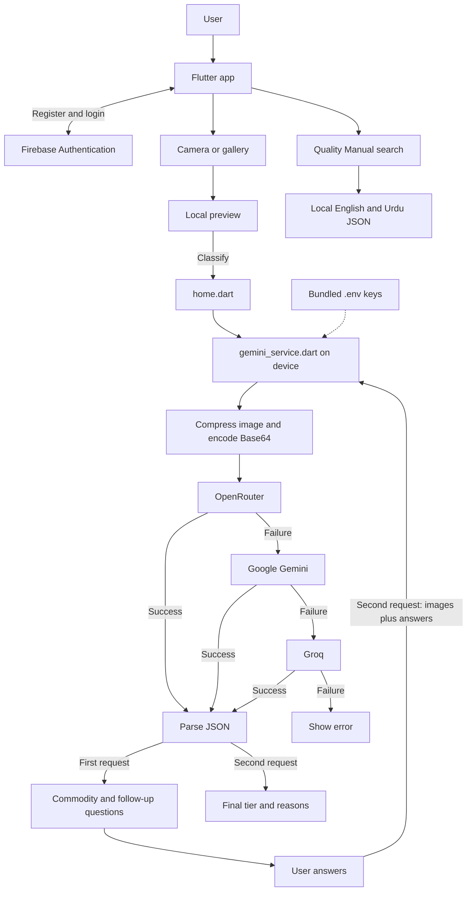
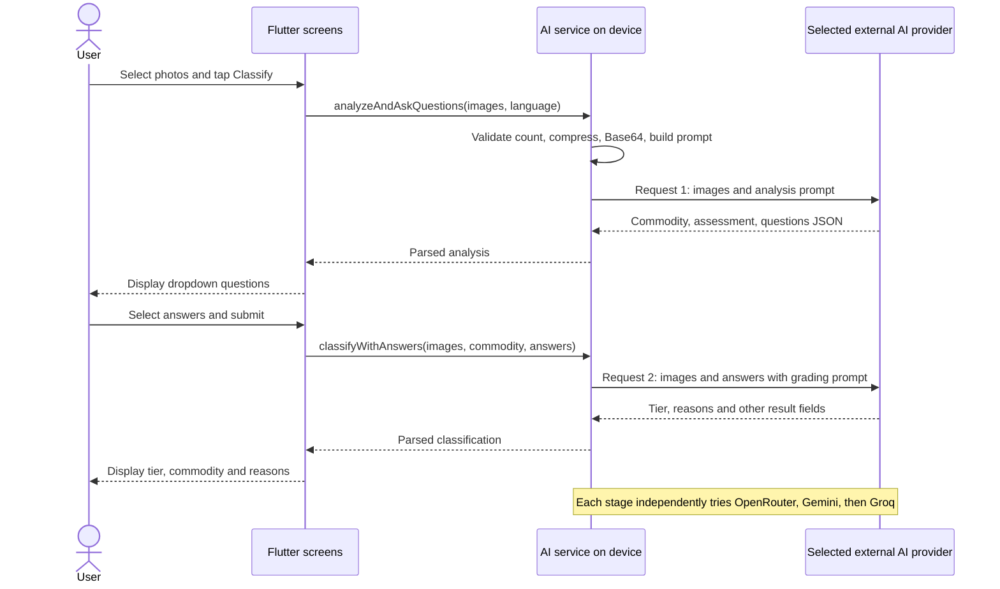
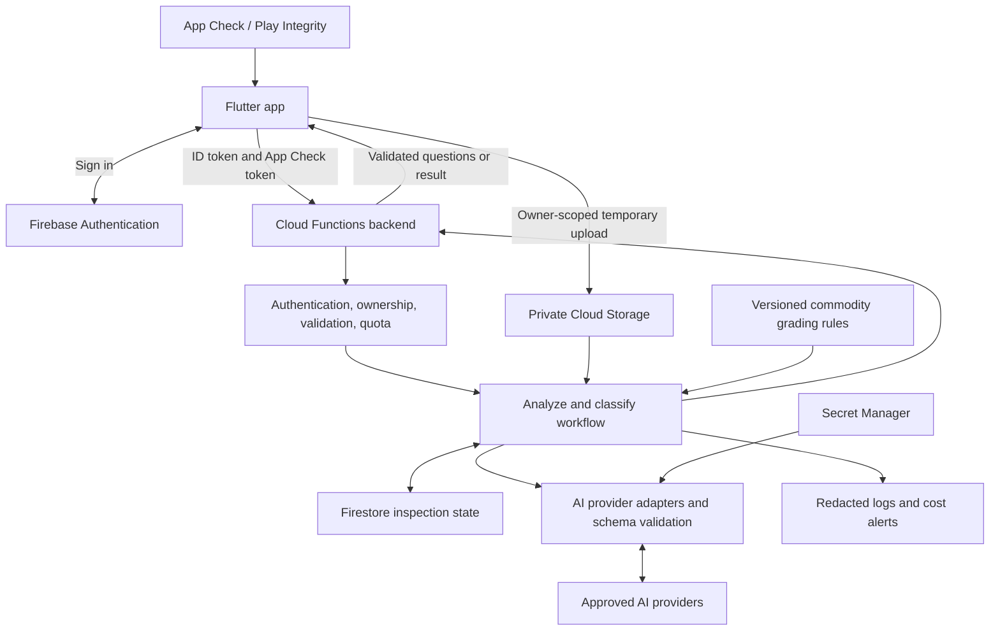

**JeoKissan QMS — Architecture aur Production Readiness Review**

Review date: 6 October 2026. Zaban: Roman Urdu, technical terms English mein.

**Faisla:** App ka image → questions → classification workflow working prototype hai. Public Google Play production release ke liye abhi ready nahi. Sab se pehle provider keys ko server par move karna, password-reset flow theek karna, release signing, account deletion/privacy, aur Android release verification complete karni chahiye.

Yeh repository-based review aur proposed architecture hai. Recommended backend ke components abhi repository mein implemented nahi hain. Firebase Console, provider billing/privacy settings aur Play Console access is review ka hissa nahi tha; unki settings ko verified assume na karein.

**1. Abhi app ka actual architecture**

Is repository mein custom application backend/API server nahi mila. Flutter app UI ke saath AI request orchestration bhi device/browser par chalati hai. Firebase Authentication managed authentication backend hai. Image analysis OpenRouter, Google Gemini aur Groq ke external APIs par hota hai.



Editable diagram: [architecture-current.mmd](architecture-current.mmd).

**2. User image select karta hai to kya hota hai?**

| Step | Actual behavior | Code |
|---|---|---|
| Startup | `.env` load, Firebase initialize, saved language load, splash aur current-user check | [main.dart](../lib/main.dart), [splash.dart](../lib/splash.dart) |
| Authentication | Email/password registration aur login; display name Firebase user profile par update | [register.dart](../lib/register.dart), [login.dart](../lib/login.dart) |
| Image selection | Camera se single image ya gallery se multiple `XFile` objects | [home.dart](../lib/home.dart) |
| Preview | Image local device/browser par display hoti hai. Is point par AI upload nahi hota | [preview_image.dart](../lib/preview_image.dart) |
| Classify | Loading dialog; image bytes read; current language service ko pass | [home.dart](../lib/home.dart) |
| Preprocessing | Decode, orientation fix, longest side at most 800 pixels, JPEG quality 70, Base64 | [gemini_service.dart](../lib/gemini_service.dart) |
| Analysis call | Images + prompt + supported commodity names → first available successful AI provider | `analyzeAndAskQuestions()` |
| Questions | Commodity, preliminary assessment aur prompt ke mutabiq 4–5 dropdown questions; user kam az kam ek answer de sakta hai | [questions_screen.dart](../lib/questions_screen.dart) |
| Classification call | Wohi original image bytes dobara compress/encode hoti hain; commodity aur selected question/answer text ke saath new AI request | `classifyWithAnswers()` |
| Result | UI quality tier, commodity, reasons aur photos dikhati hai | [classification_result.dart](../lib/classification_result.dart) |

Final prompt `confidence`, `corrective_actions` aur `notes` bhi mangta hai. Current result-screen constructor tak yeh fields pass nahi hoti; inhein result UI mein displayed assume na karein.



Do alag remote AI operations hain. Second operation mein provider ko pehle request ki conversation memory automatically nahi milti; app relevant images aur answers dobara send karti hai. Dono stages alag providers par successful ho sakte hain.

**3. Requests aur data ki boundaries**

| Item | Current implementation |
|---|---|
| Provider order | OpenRouter `openrouter/free` → Gemini `gemini-2.5-flash` → Groq `qwen/qwen3.8-27b`; yeh code configuration hai, availability guarantee nahi |
| Authentication | OpenRouter/Groq: provider API key as Bearer token; Gemini: `x-goog-api-key` header |
| Firebase user identity | AI provider requests mein Firebase ID token/UID authorization use nahi hoti |
| Request format | OpenRouter/Groq: chat messages with image data URLs; Gemini: `contents`, `inlineData`, `systemInstruction`, generation config |
| Limits | Service accepts 1–4 images; Groq branch more than 3 images par skip hoti hai |
| Payload check | Total encoded image characters 7,000,000 se zyada hon to reject; yeh raw-image memory/dimension guard nahi |
| Timeout | Har provider attempt 90 seconds; slow failures mein 3 attempts lagbhag 270 seconds per stage le sakte hain |
| Total calls | Successful complete flow normally 2 calls; fallback se up to 6 attempts, potentially about 540 seconds of network waiting across both stages |
| Result storage | Repository mein inspection history ke liye database write nahi; photos, questions aur results current widget/session memory mein hain |
| Preferences | Language `SharedPreferences` mein persist hoti hai |
| Manual | English/Urdu JSON assets se local search; classification prompt mein detailed manual criteria load nahi hote |
| Own hosting | `firebase.json` mein static Flutter web hosting configuration hai; Functions/API backend configuration nahi |

App apni image-storage upload API use nahi karti. Base64 bytes directly external providers ko send hote hain. Apni database mein image save na hona yeh prove nahi karta ke AI providers image/request retain nahi karte; provider settings aur terms separately verify honge. Fallback hone par ek hi image multiple providers tak ja sakti hai.

**4. Kaun se folders/files kya responsibility lete hain?**

| Area | Responsibility |
|---|---|
| `lib/main.dart`, `splash.dart`, `firebase_options.dart` | Bootstrap, routes, theme, Firebase configuration, startup authentication check |
| `lib/login.dart`, `register.dart`, `forgot_password.dart` | Firebase email/password flows |
| `lib/home.dart` | Image picker aur dono AI stages ki orchestration; navigation aur loading/error handling bhi isi screen mein |
| `lib/preview_image.dart`, `questions_screen.dart`, `classification_result.dart` | Preview, user answers, classification presentation |
| `lib/gemini_service.dart` | Image processing, prompts, provider adapters, fallback, response parsing; naam Gemini hai lekin teen providers handle karta hai |
| `lib/commodity_name_mapping.dart` | Supported names/Urdu mappings; custom trained image model nahi |
| `lib/quality_manual_service.dart`, `quality_manual_search.dart` | Local grading reference data load/search |
| `lib/locale_provider.dart`, `app_localizations.dart` | App language state, saved locale, translated strings |
| `lib/settings_screen.dart`, `faq_screen.dart` | User profile display, support links, language, sign-out, help |
| `assets/` | Images, fonts aur manual datasets |
| `android/`, `ios/`, `web/`, desktop folders | Platform packaging/build configuration |
| `test/` | `widget_test.dart` empty hai; meaningful automated tests repository mein nahi mile |

**5. Production findings, priority order mein**

`P0` = public production se pehle fix. `P1` = release readiness ke liye high-priority reliability/product work. Yeh engineering priorities hain; har item ko Google Play ki direct policy violation kehna durust nahi hoga.

| Priority | Finding aur evidence | Asar aur recommended action |
|---|---|---|
| P0 | Provider secrets packaged as assets: `pubspec.yaml` assets mein `.env`; `main.dart:19`; `gemini_service.dart:33` | Distributed APK/AAB se assets aur web build se keys extract ho sakti hain. Server-only Secret Manager aur authenticated backend use karein; distributed/exposed provider keys rotate karein. `.gitignore` aur obfuscation is boundary ko secure nahi karte |
| P0 | AI usage ke liye owned backend authorization/quota layer nahi: `gemini_service.dart:226` | Firebase login app navigation ko gate karta hai, extracted provider credential ke direct use ko nahi. Per-user quotas, ownership, concurrency/cost controls backend par enforce hon |
| P0 | Forgot-password account existence check ke liye account create/delete: `forgot_password.dart:52` | Authentication state change ho sakti hai, deletion fail hone par temporary account reh sakta hai, account existence reveal hoti hai. Direct reset-email request aur generic success message use karein |
| P0 | Release debug key se signed: `android/app/build.gradle.kts:35` | Production upload signing config aur Play App Signing setup karein. Upload key secrets repository mein na rakhein |
| P0 | Signup available, lekin user-facing delete-account path aur linked privacy policy repo mein nahi mili: `register.dart`, `settings_screen.dart` | Account deletion in-app + public web request path, accurate Privacy Policy aur Data safety declarations add karein; live Console configuration abhi unverified |
| P1 | Provider/model availability unstable | Last observed debug session mein OpenRouter invalid response, Gemini HTTP 404 aur Groq analysis success tha. Model capability/availability checks, supported JSON output aur production provider config verify karein; current review ne paid image calls repeat nahi kiye |
| P1 | Quality Manual AI grading se connected nahi: `quality_manual_service.dart:30`, `gemini_service.dart:398`, `:662` | Commodity name list aur generic five-tier prompt custom grading validation nahi. Selected commodity ke versioned criteria backend par include/enforce karein |
| P1 | Partial JSON validation: `gemini_service.dart:350`, `:512`, `:725` | Valid JSON object ko semantic schema pass samjha jata hai. Questions/answers types, option limits, allowed tier/commodity IDs aur numeric ranges validate hon. Schema-invalid result ko success mark karne se pehle fallback/repair decide karein |
| P1 | Urdu tier strings aur English-only colors: `classification_result.dart:26` | Urdu `Unsatisfactory` response switch se match nahi karta, default green mil sakta hai. Stable enum `UNSATISFACTORY` transport karein; translation sirf display layer mein karein |
| P1 | Image memory/UI performance: `home.dart:44`, `:88`, `gemini_service.dart:63` | Gallery selection unbounded hai; bytes pehle load hote hain aur compression synchronous hai. Picker-level cap, raw bytes/pixel limits, native isolate processing aur Android picker recovery add karein |
| P1 | Long sequential waits aur repeated uploads: `gemini_service.dart:286`, `:619` | Per-stage total deadline, cancel behavior, invalid-key/config circuit breaker, transient-error backoff aur prepared image reuse implement karein |
| P1 | Prompt commodity ko closest supported variety guess karne par zor deta hai: `gemini_service.dart:446` | Misidentification ka risk. `UNKNOWN`/`NEEDS_REVIEW` state, user confirmation aur representative labeled evaluation add karein |
| P1 | AI assessment/accuracy claims validated nahi | Repo mein custom trained model ya accuracy evaluation nahi mili. FAQ `app_localizations.dart:336` Gemini-specific claim karta hai jabke runtime multiple providers use karta hai. Product claims ko tested behavior ke saath align karein |
| P1 | UI/lifecycle defects | Pichle run mein `home.dart:376` par 41-pixel vertical overflow report hua. Analyzer mein 3 asynchronous BuildContext notices. Small-screen, keyboard, back navigation aur large text checks zaroori hain |
| P1 | Android release verification absent | `flutter doctor -v` Android SDK locate nahi kar saka. Chrome success ko Android release proof na samjhein; signed Android bundle/device tests required |
| P2 | Observability/tests missing | Empty test file; no Crashlytics/backend metrics integration found. Result content print hota hai. Redacted logs with request IDs, latency/provider/cost metrics, crash reporting aur failure-path tests add karein |

`android/app/src/main/AndroidManifest.xml` mein explicit `INTERNET` permission nahi, jabke debug/profile manifests mein hai. Release merged manifest inspect karein; dependency permission merge ho sakti hai, is liye current release ko conclusively network-broken nahi kaha ja raha. App network use karti hai, is liye main manifest mein explicit declaration rakhna munasib hai. [Flutter Android release guide](https://docs.flutter.dev/deployment/android)

`applicationId` abhi `com.example.jeokissan_5t_quality_management_system` hai. First publication se pehle owned, permanent package ID choose karein aur Firebase Android registration/configuration align karein. `com.example` hona apne aap confirmed Play rejection ka proof nahi, lekin production identity decision pending hai.

**6. Recommended production architecture**

Is app ke liye meri recommendation: **Flutter + Firebase Auth + App Check + TypeScript Cloud Functions + Secret Manager**, aur inspection state ke liye **Firestore**, temporary image reuse ke liye **private Cloud Storage**. Ek backend codebase se shuru karein; is scale par microservices ki zarurat establish nahi hui.



Editable diagram: [architecture-production.mmd](architecture-production.mmd).

Firebase callable SDKs available authentication/App Check tokens requests mein attach kar sakte hain. Backend par authenticated user explicitly require karna, resource ownership check karna aur App Check enforcement configure karna phir bhi zaroori hai. App Check rate limiting aur authorization ka replacement nahi. [Callable functions](https://firebase.google.com/docs/functions/callable), [App Check enforcement](https://firebase.google.com/docs/app-check/cloud-functions)

AI keys sirf server functions ko Secret Manager se milni chahiye. Flutter ko provider API keys return na karein. [Firebase secret configuration](https://firebase.google.com/docs/functions/config-env)

**7. Proposed backend operations aur request lifecycle**

Neeche names proposed callable operations hain; yeh currently implemented REST endpoints nahi hain.

| Operation | Client input | Server ka kaam / response |
|---|---|---|
| `createInspection` | `locale`, image metadata, idempotency key | User/App Check/quota validate; UID-owned inspection ID aur allowed private object paths return |
| Image upload | Authorized image bytes to assigned paths | Storage rules ownership/count/type/size limit enforce; backend actual file content, dimensions aur decode validity dobara verify kare |
| `analyzeInspection` | `inspectionId`, idempotency key | Owned images load; normalize; quality checks; selected provider call; validated `commodityId`, assessment, questions with stable IDs/options persist/return |
| `classifyInspection` | `inspectionId`, answer IDs/options, idempotency key | Saved questions se answers verify; relevant grading criteria load; validated canonical result persist/return |
| `getInspection` | `inspectionId` | Owner-only status/result; app process restart ke baad resume |
| `reportInspection` | `inspectionId`, reason, optional feedback | User report save; review queue mein route; image retention scope clearly disclose |
| `deleteAccount` | Recent authenticated request | Account access revoke/delete, associated records/images cleanup; retries aur cleanup status handle |

Client-supplied `uid`, grade, question text, object path ya arbitrary remote URL ko trusted na samjhein. Owner ID verified Firebase token se nikalein. Storage object name allowed inspection prefix ke andar ho; arbitrary URL download path se SSRF risk introduce na karein.

Initial implementation bounded synchronous calls use kar sakti hai agar measured latency acceptable ho. Agar processing app/network timeout se lambi ho, durable job + status response use karein; request complete hone ke baad server memory mein untracked background work chhorna reliable nahi. Async mode mein at-least-once retries ko idempotency aur job state transitions se handle karein.

Recommended state flow: `UPLOADING → ANALYZING → AWAITING_ANSWERS → CLASSIFYING → COMPLETED`, saath `FAILED`, `CANCELLED`, `EXPIRED` states. Question-set version ke baghair stale answers accept na hon.

**8. Data aur validation design**

| Proposed record | Minimum useful fields |
|---|---|
| `inspections/{inspectionId}` | Owner UID, status, image references, locale, commodity ID, question/answer IDs, canonical result, timestamps, model/provider, prompt version, manual version, expiry |
| `usage/{uid_period}` | Atomic quota reservation, attempt/result counters, budget usage; client direct writes disallow |
| `reports/{reportId}` | Owner/request reference, category, submitted feedback, review status |
| Grading criteria | Stable commodity/tier IDs, version, reviewed criteria and localized descriptions |

Suggested result shape:

```json
{
  "inspectionId": "generated-id",
  "status": "COMPLETED",
  "commodityId": "apple_red_delicious",
  "tier": "GOOD",
  "reasons": ["Visible surface condition is consistent with the selected criteria"],
  "correctiveActions": [],
  "needsReview": false,
  "manualVersion": "reviewed-version",
  "promptVersion": "version-id"
}
```

`confidence` add karna ho to uski meaning aur calibration define karein. Model ka self-reported `0.95` automatically 95% measured accuracy nahi hota. Unknown commodity, unclear image aur contradictory answers ko `NEEDS_REVIEW`/abstention response dena valid outcome ho.

Private object storage history feature ki lazmi condition nahi: images ko sirf dono stages complete karne/resume ke liye temporarily rakh sakte hain. Retention duration product decision hai; policy mein exact period disclose karein, expired uploads cleanup karein, backups aur third-party provider handling bhi account mein lein. Sirf Firestore TTL lagana Storage images delete nahi karta.

**9. Proposed code organization**

```text
lib/
  app/                       bootstrap, routing, theme
  core/                      API errors, config, logging, shared models
  features/
    auth/                    screens, auth repository, account deletion
    inspection/
      presentation/          preview, questions, results
      application/           controller and inspection state
      domain/                typed inspection/question/tier models
      data/                  backend API and upload repository
    quality_manual/          local manual viewer
    settings/                language, privacy, support
functions/
  src/
    auth/                    user and App Check guards
    inspections/             callable handlers, workflow, schemas
    providers/               adapters and provider selection
    grading/                 versioned rules and validation
    usage/                   quota, budgets, idempotency
    privacy/                 account deletion and retention jobs
    observability/           redacted logging and metrics
  test/                      contract, authorization, fallback tests
test/                        Flutter unit and widget tests
integration_test/            full device workflows
firestore.rules
storage.rules
```

Existing `Provider` package ko inspection controller ke saath use karna kaafi ho sakta hai. Architecture improve karne ke liye Bloc/Riverpod migration apne aap required nahi. Main change screen callbacks se business workflow ko typed controller/repository mein move karna hai.

**10. Google Play requirements aur release gate**

6 October 2026 ko checked official documentation ke mutabiq:

| Item | Aap ke project par implication |
|---|---|
| Target API | 31 August 2026 se new phone apps/updates ko Android 16 / API 36 ya higher target karna hai. Current installed Flutter SDK default target 36 hai aur project Flutter default use karta hai. Final built bundle ka target verify karna baqi hai |
| Signed app bundle | Production upload key, Play App Signing aur signed `.aab` build configure karein; current debug-signing config replace honi chahiye |
| Privacy/Data safety | In-app aur Play Console Privacy Policy, accurate collection/use/disclosure, retention/deletion details. Photos, account information aur external AI processing ko actual handling ke mutabiq declare karein |
| Account deletion | Account creation ke saath in-app deletion/request path aur external web resource required; associated data cleanup bhi |
| Personal developer testing | Agar personal Play developer account 13 November 2023 ke baad bana hai: at least 12 testers continuously opted in for 14 days, phir production access application. Account type/date is review mein verified nahi |
| AI-generated content | App generated questions/reasons deti hai. Policy applicability assess karein; applicable AI apps mein in-app reporting/flagging required. Result par report action recommended hai |
| Native compatibility | Flutter/plugin native libraries ka 16 KB compatibility aur real-device behavior final build par verify karein; AGP/NDK version dekhna compatibility test ka substitute nahi |
| Review access | Login-required app ke reviewer access instructions/test credentials, content rating, target audience, store listing/assets aur support contact complete karein |

API rule ka source: [Google Play target API levels](https://support.google.com/googleplay/android-developer/answer/11926878?hl=en). Signing/AAB guidance: [Flutter Android deployment](https://docs.flutter.dev/deployment/android).

Data requirements: [Google Play User Data](https://support.google.com/googleplay/android-developer/answer/10144311), [Account deletion requirements](https://support.google.com/googleplay/android-developer/answer/13327111?hl=en). Testing requirement aur review access: [Personal developer account testing](https://support.google.com/googleplay/android-developer/answer/14151465?hl=en).

AI reporting: [Google Play AI-generated content policy](https://support.google.com/googleplay/android-developer/answer/13985936?hl=en). Native compatibility: [Android 16 KB page-size guidance](https://developer.android.com/guide/practices/page-sizes). Public documentation review Play approval ki guarantee nahi; actual Console validation aur submitted build review final checks hain.

**11. Verification jo is review mein hui**

| Check | Result |
|---|---|
| Repository/source review | UI workflow, authentication, requests/prompts, manual lookup, Android config, test coverage files inspect kiye |
| `flutter analyze --no-pub` | 0 errors, 0 warnings, 47 info-level notices: 43 `avoid_print`, 3 `use_build_context_synchronously`, 1 `unnecessary_import`; command exit 1, is liye clean lint pass nahi |
| `flutter doctor -v` | Flutter 3.47.6 / Dart 3.13.5; Chrome available; Android SDK not found; Android release build verified nahi |
| Existing runtime evidence | Pichle fresh run mein Groq ne image se follow-up questions generate kiye; usi session mein OpenRouter invalid response, Gemini 404 aur home-layout overflow report hua |
| Automated app tests | `test/widget_test.dart` empty; passing suite ka claim nahi |
| Out of scope/unverified | End-to-end Android classification, signed AAB, device/emulator coverage, measured AI accuracy, provider retention/billing settings, deployed security rules, live Play Console setup |

**12. Implementation order aur acceptance criteria**

1. **Secure AI backend:** Server-only keys, verified user/App Check, ownership rules, quotas, supported provider configuration. Acceptance: distributed app mein provider secret na ho; unauthenticated, over-quota aur cross-user requests reject hon.
2. **Reliable classification:** Typed schemas, canonical tier IDs, manual-grounded criteria, unknown/review state, idempotency/deadlines. Acceptance: malformed JSON, truncated output, four-image fallback, invalid answers aur EN/UR results expected behavior dein.
3. **Account/privacy fixes:** Reset flow replace; delete-account plus public request page; correct Privacy Policy/Data safety; redacted logs. Acceptance: reset account create na kare, deletion related records/images cleanup kare, user data handling actual system se match kare.
4. **Android release:** SDK install/configure, permanent package ID, Firebase Android config, signing, merged manifest, native compatibility, signed AAB. Acceptance: physical Android device par release build ka signup/login, camera/gallery, two-stage classification aur failure handling pass ho.
5. **Quality/release testing:** Labeled commodity test set, per-tier confusion matrix, wrong acceptance cases, unclear photos, prompt injection in images, network loss, memory pressure, app background/restart, deletion aur accessibility tests. Acceptance thresholds product/domain team pehle define kare; ek successful image se accuracy percentage conclude na karein.
6. **Controlled rollout:** Internal/required closed testing, reviewer access, crash/latency/cost alerts, provider outage procedure aur rollback plan ke baad staged production release.

Meri engineering recommendation: pehle secure backend aur release blockers complete karein, phir signed Android build ka controlled test chalayein. Existing two-stage UX reuse ho sakta hai; production trust boundary ko device se server par move karna sab se zaroori architectural kaam hai.
